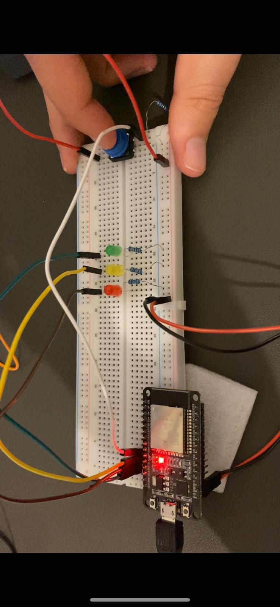
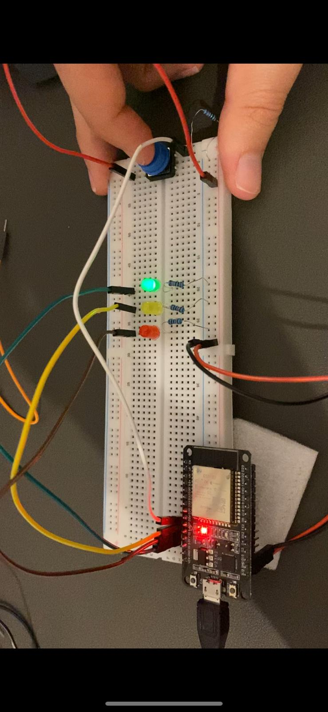
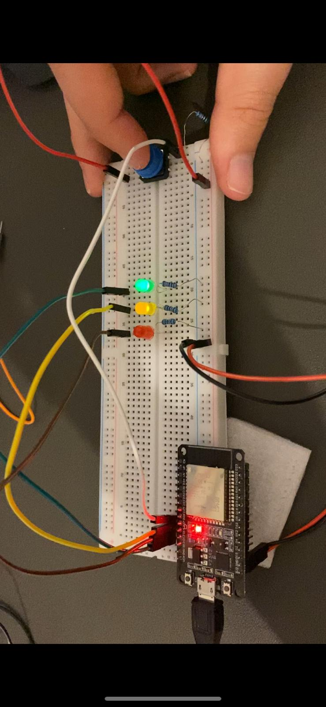
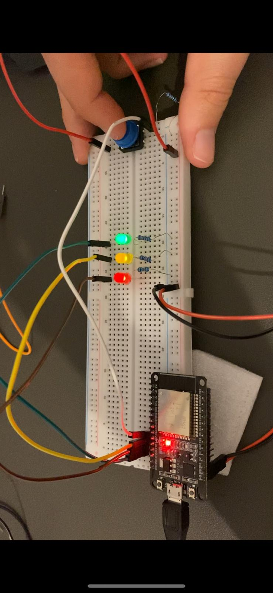
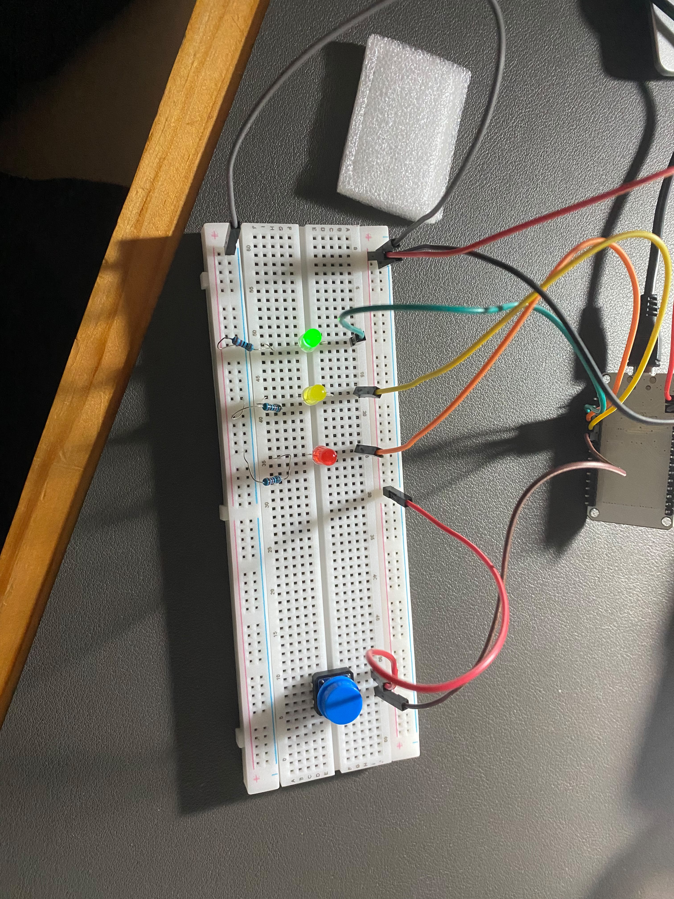
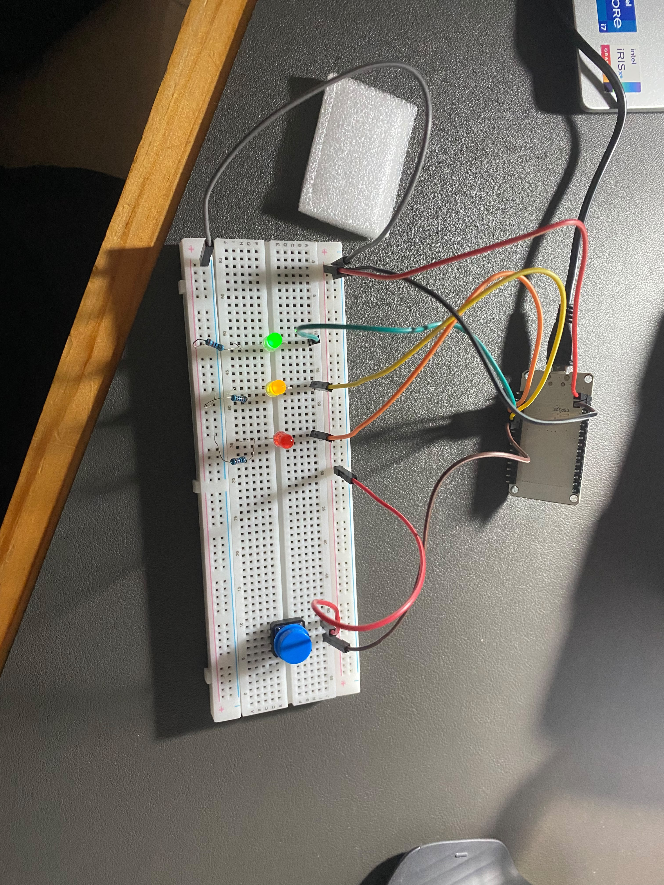
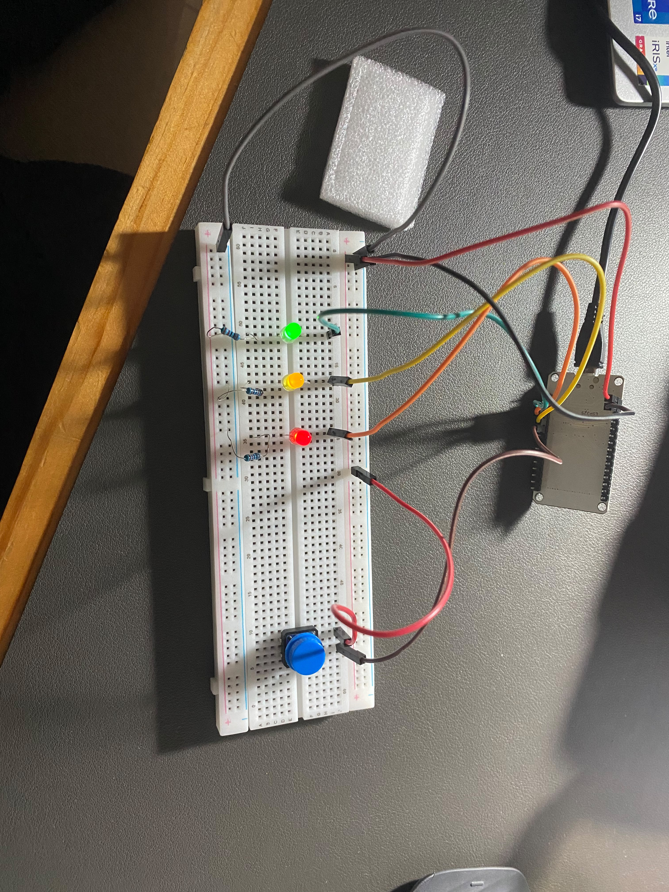
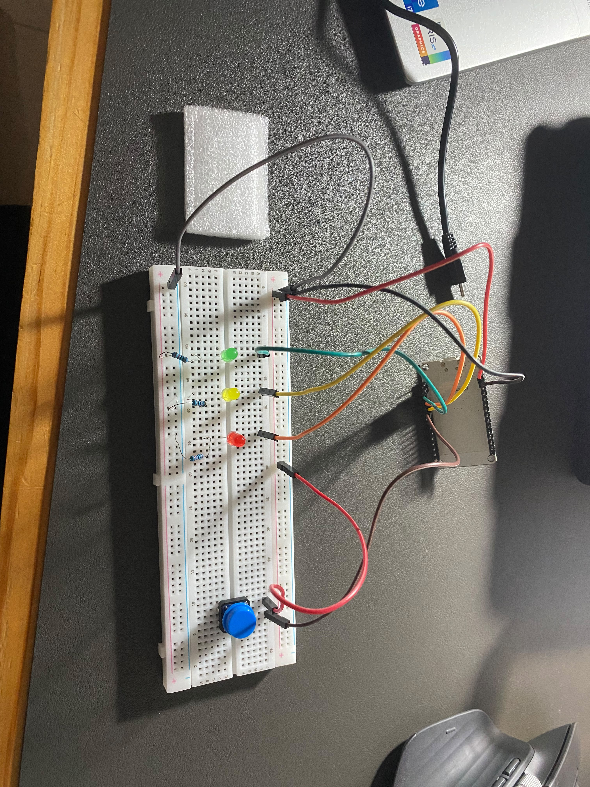

# Development Log

This document is meant to track my progress throughout the Stoplight Timer project, including what I've tried, what worked (and what didn't), and anything interesting I've learned along the way.

## V1 — Initial Implementation

### First Attempt — Putting Everything Together

My first attempt was to take the [timer code](https://github.com/Noam-Moskowitz/stoplight-timer/blob/20cc8ad87fa04e70f6ca057122f65a9baeb8a97c/main/main.ino) I'd written and pair it with my original [circuit wiring](https://github.com/Noam-Moskowitz/stoplight-timer/blob/20cc8ad87fa04e70f6ca057122f65a9baeb8a97c/main/circut_state.svg) (commit `20cc8ad`).

And... it didn't work.

At first, I thought the issue was probably my code, which isn't perfect and honestly could still be part of the problem. But after looking into it a little more, I realized there was a bigger issue with how I'd wired the button.

So instead of trying to figure out everything that was wrong with the project at once, I figured I'd try something simpler. Before worrying about the timer, **can I even wire a button properly and reliably track when it's being pressed?**

### Second Attempt — Getting the Button Working

That's where [manual_switch.ino](https://github.com/Noam-Moskowitz/stoplight-timer/blob/20cc8ad87fa04e70f6ca057122f65a9baeb8a97c/manual_switch/manual_switch.ino) came in (commit `20cc8ad`).

I started by stripping the circuit down to just the ESP32 and a push button. The idea was to use `digitalRead()` to read the button's state, store the result in a `buttonState` variable, and print it to the Serial Monitor.

Pretty simple, right? Well, apparently not, because even that wasn't working properly.

After a bit of research, I realized I'd completely left out a resistor in the button's circuit. Without a pull-up or pull-down resistor, the input pin can be left floating, meaning it doesn't have a reliable HIGH or LOW reading.

I also found out that the ESP32 actually has internal pull-up resistors that can be enabled through the code, although I haven't tried that yet.

Once I added the resistor, I was finally able to read the button's state much more reliably.

### Third Attempt — Testing the Button With LEDs

Now that I could actually read the button's state, I wanted to take it a little further and see how reliable it was.

I wired up my three LEDs and added some code to track how many times the button had been pressed using a `timesPressed` variable.

The idea was to increment the variable every time the button was pressed, and once it reached 3, the next press would reset it back to 0.

I then used a `switch` statement to control which LEDs should light up depending on that value:

| `timesPressed` | LED State |
|---|---|
| 0 | All LEDs off |
| 1 | Green |
| 2 | Green + Yellow |
| 3 | Green + Yellow + Red |

This let me test a few things at once: reading the button's state, counting button presses, and controlling multiple GPIO output pins based on that count.

And as you can see in the photos and video below, **it actually worked!**

### Test Results

Here are the four states of the circuit:

**State 0 — All LEDs Off**

**State 1 — Green LED**

**State 2 — Green + Yellow LEDs**

**State 3 — All Three LEDs**

### Fourth Attempt — Getting the Timer Working (Sort Of)

After confirming I could track button presses and control the LEDs, I decided to try something a little more controlled. **Could I get a fixed 30-second timer working and have the LEDs correctly show which third of the countdown I was in?**

I also wanted to take this opportunity to figure out how the ESP32's built-in pull-up and pull-down resistors actually work.

For this test, I wrote a separate script: [set_timer.ino](https://github.com/Noam-Moskowitz/stoplight-timer/blob/main/set_timer/set_timer.ino).

#### Figuring Out the Internal Resistors

As I learned in my previous attempt, a button connected to a GPIO pin without a pull-up or pull-down resistor can leave the pin floating, giving random HIGH/LOW readings when the button isn't pressed. Last time, I solved this by adding an external pull-down resistor.

This time, I wanted to try using `INPUT_PULLUP` and `INPUT_PULLDOWN` instead.

So I removed the resistor, wired one side of the button to power, the other to ground, and connected the GPIO pin somewhere in between. Compiled, uploaded, and... the button was constantly being pressed.

After some messing around with the wiring and debugging, it clicked.

**With `INPUT_PULLUP`, the button only needs to connect the GPIO pin to GND. With `INPUT_PULLDOWN`, it needs to connect the GPIO pin to 3.3V.**

The ESP32 uses its internal resistors to keep the pin in a defined state when the button isn't pressed:

- `INPUT_PULLUP`: Normally HIGH, LOW when pressed.
- `INPUT_PULLDOWN`: Normally LOW, HIGH when pressed.

Basically, I no longer need the external resistor or to wire both power and ground to the button. The ESP32 handles the pull-up/pull-down part internally.

#### Testing the 30-Second Timer

Once I got the button working, the rest was pretty straightforward.

I set the timer to 30 seconds, split it into three 10-second chunks, and had the LEDs change depending on which third of the countdown I was in. I also added the ability to restart the timer with a button press.

And it worked!

It's still a simplified version with a fixed timer, but at least now I know I can get the countdown, LEDs, and button working together.

#### Test Results

Here are the four states of the 30-second countdown:

**First 10 Seconds — Green**

**Middle 10 Seconds — Yellow**

**Last 10 Seconds — Red**

**Timer Finished**

**Video — Manual Switch in Action**

[Watch the button and LEDs in action](https://github.com/Noam-Moskowitz/stoplight-timer/blob/main/manual_switch/media/manual_switch_in_action.mp4)

